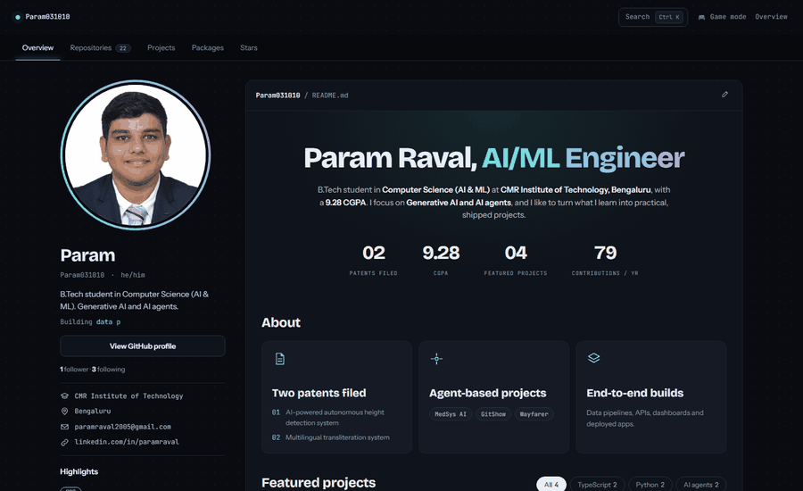

**▶ [Open the live interactive portfolio](https://param031010.github.io/Param031010/)** · [Projects](https://param031010.github.io/Param031010/#/projects) · [Repositories](https://param031010.github.io/Param031010/#/repositories) · [Game mode](https://param031010.github.io/Param031010/game/)

Live GitHub data, project details and a command palette (<code>Ctrl K</code>). Click the preview above to explore it.

---

**Param Raval, AI/ML Engineer.** B.Tech student in **Computer Science (AI & ML)** at **CMR Institute of Technology, Bengaluru**, with a **9.28 CGPA**. I focus on **Generative AI and AI agents**, and I like to turn what I learn into practical, shipped projects.

| | |
|---|---|
| 📄 **2 patents filed** | AI-powered autonomous height detection system · Multilingual transliteration system |
| 🤖 **Agent-based projects** | MedSys AI · GitShow · Wayfarer |
| 🏗️ **End-to-end builds** | Data pipelines, APIs, dashboards and deployed apps |

## Featured projects

1. [**MedSys AI**](https://github.com/Param031010/MedSysAI_01): health app with document-grounded chat, symptom knowledge graphs and nearby-care search
2. [**GitShow**](https://git-show-seven.vercel.app/): chat assistant for exploring and acting on GitHub repos, with confirm-before-write
3. [**Wayfarer**](https://github.com/Priyanshu-Madhup/Wayferer): AI travel planner, a Gemini-powered agent that researches trips and builds the itinerary, budget and map
4. [**Dispatch.AI**](https://github.com/Param031010/Dispatch.AI): AI-assisted dispatch application

## Stack

| | |
|---|---|
| **Programming languages** | C, Java, Python |
| **Generative AI & LLMs** | Prompt engineering, Retrieval-Augmented Generation (RAG), fine-tuning LLMs (LoRA based), working with LLMs |
| **Frameworks** | NumPy, Pandas, Matplotlib, Seaborn, LangChain, FastAPI, Scikit-Learn, TensorFlow, Transformers, HuggingFace |
| **Databases** | MongoDB, MySQL, FAISS, Pinecone |
| **Web technologies** | HTML, CSS, JavaScript |
| **Tools & deployment** | Git & GitHub, REST APIs, Vercel |
| **Operating systems** | Windows |

## Latest repositories

<!-- REPOS:START -->
<!-- REPOS:END -->

## Connect

[LinkedIn](https://www.linkedin.com/in/paramraval) · [LeetCode](https://leetcode.com/Param_03) · [paramraval2005@gmail.com](mailto:paramraval2005@gmail.com)
